# Paws: Pet Adoption Network

Paws is a website that helps people in Lebanon find a pet to adopt. You can browse pets, filter them, read about each pet and its shelter, and create an account as an adopter or as a shelter. It works on phones and computers, and has a light and a dark mode.

This is **Phase 1** of a university group project. Phase 1 is the front end only (what you see in the browser). There is no server or database yet, so the app uses pretend data that lives in the browser (see [How the mock data works](#how-the-mock-data-works)). The back end will be built with Node.js in Phase 2.

## Team

| Name | Pages |
|---|---|
| Eyad Oumar | Pet List, Register form |
| Omar Bacha | Home page, Login page |
| Kareem Mobayed | Pet Details page, Shelter Details page |
| Shawki EL Ghandour | Dashboard page, Add/Edit pet form |

## Topic and data

**Assigned topic:** Pet Adoption Network

The app works with four kinds of data:

| Data | What it is | Main information |
|---|---|---|
| **Pets** | Animals looking for a home | name, species, breed, age (in months), size, region, status (available, pending, adopted), photo |
| **Shelters** | Places that care for pets | name, region, address, phone, email, opening hours |
| **Users** | People with an account | name, email, password, role (adopter or shelter), region |
| **Adoption requests** | A user asking to adopt a pet | which pet, which user, a message, status (pending, approved, rejected) |

They are linked by ids. For example, a pet has a `shelterId` that points to its shelter, and a request has a `petId` and an `adopterId`.

Regions are Lebanon's 8 governorates: Beirut, Mount Lebanon, North, Akkar, Beqaa, Baalbek-Hermel, South and Nabatieh.

## Live website

**Live site:** _add the Vercel link here once it is deployed_

**Code:** https://github.com/eiadoumer/Paws

## Run it on your computer

### What you need
- [Node.js](https://nodejs.org/) version 20 or newer (this comes with `npm`)
- [Git](https://git-scm.com/)

### Steps
1. Download the code:
   ```bash
   git clone https://github.com/eiadoumer/Paws.git
   cd Paws
   ```
2. Install the packages the project needs:
   ```bash
   npm install
   ```
3. Start the website:
   ```bash
   npm run dev
   ```
4. Open the link it prints, usually http://localhost:5173

### Other commands
| Command | What it does |
|---|---|
| `npm run dev` | Starts the site for development. It updates as you save files. |
| `npm run build` | Makes the final version of the site in the `dist` folder. |
| `npm run preview` | Opens that final version so you can check it. |
| `npm run lint` | Checks the code for common mistakes. |

### Demo accounts
The quickest way in: on the Login page, click **Log in as Adopter** or **Log in as Shelter**. No typing needed.

To log in by hand, use one of these. All demo accounts use the password **`PawsDemo123!`**

| Email | Role |
|---|---|
| `alex@example.com` | Adopter |
| `central@example.com` | Shelter (Central Paws Rescue) |

**Where is the Dashboard?** The **Dashboard** link only shows in the top bar after you log in. Logging in also takes you straight to it.

**Note:** refreshing the page logs you out, because the login is only kept in the pretend data (see [How the mock data works](#how-the-mock-data-works)). Just log in again.

## Screenshots

**Home page**
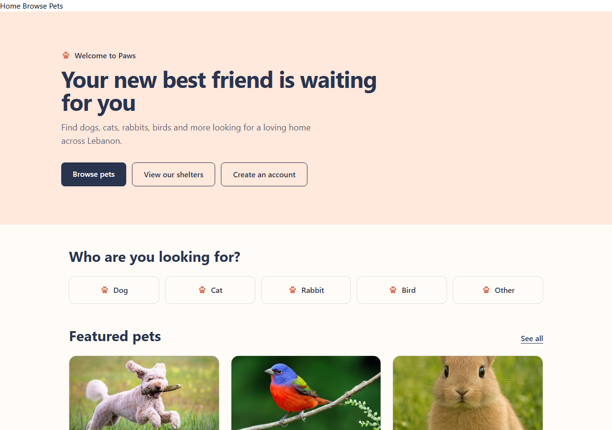

**Home page in dark mode** (switch with the moon button in the top bar)
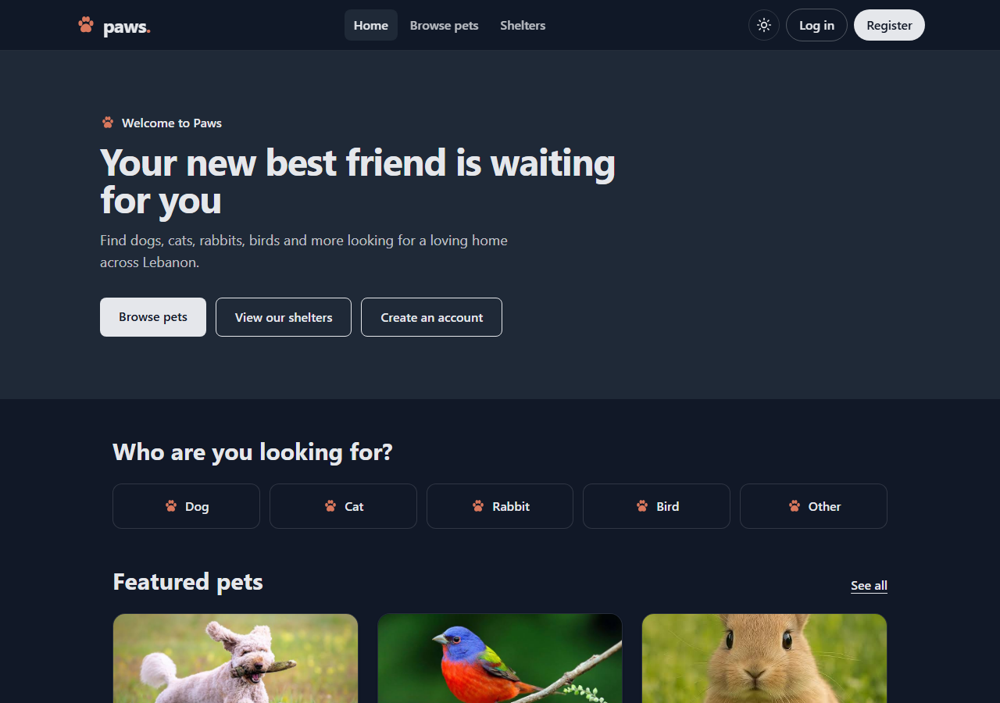

**Pet List with filters** (here: dogs, large size)
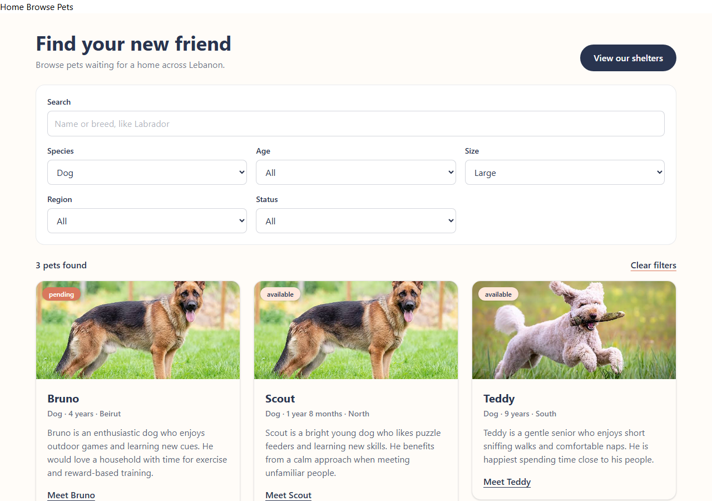

**Pet List in dark mode**
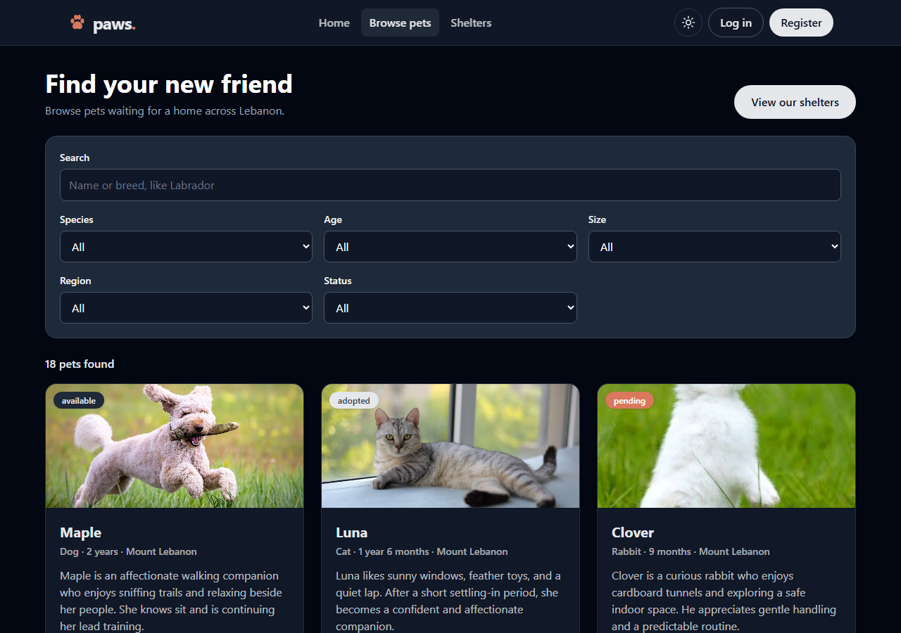

**Pet Details**
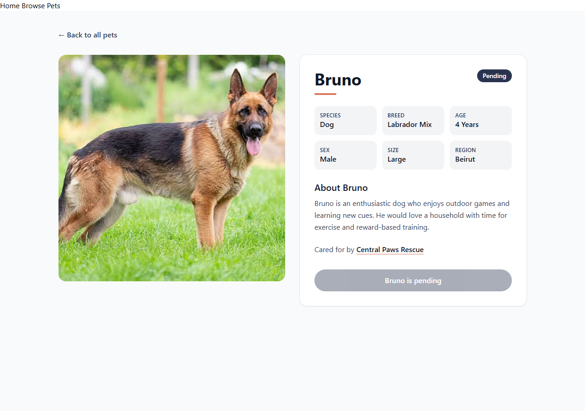

**Shelter Details**
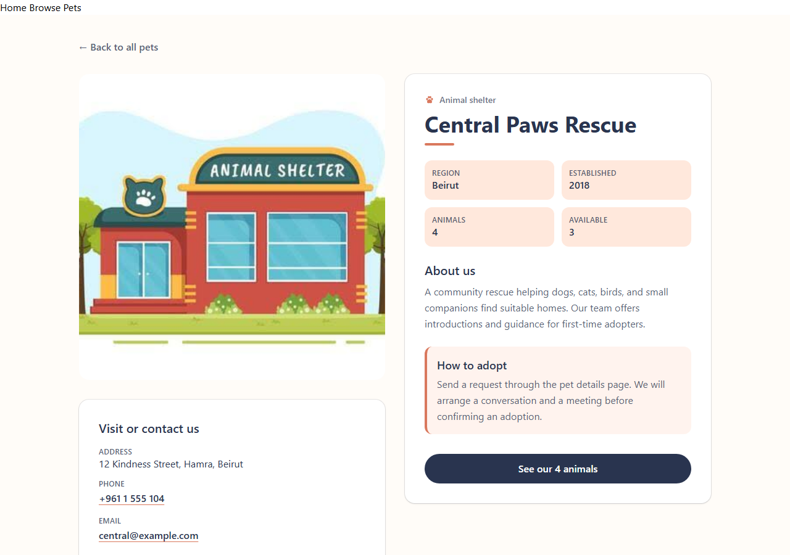

**Dashboard**
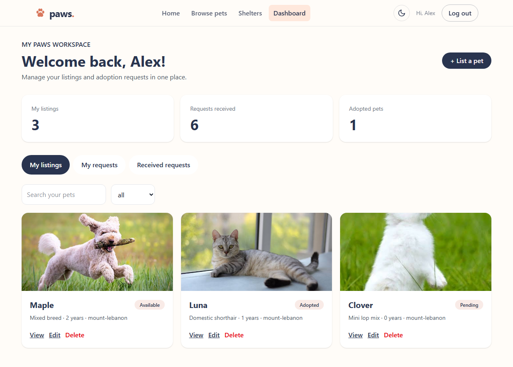

**Add a pet**
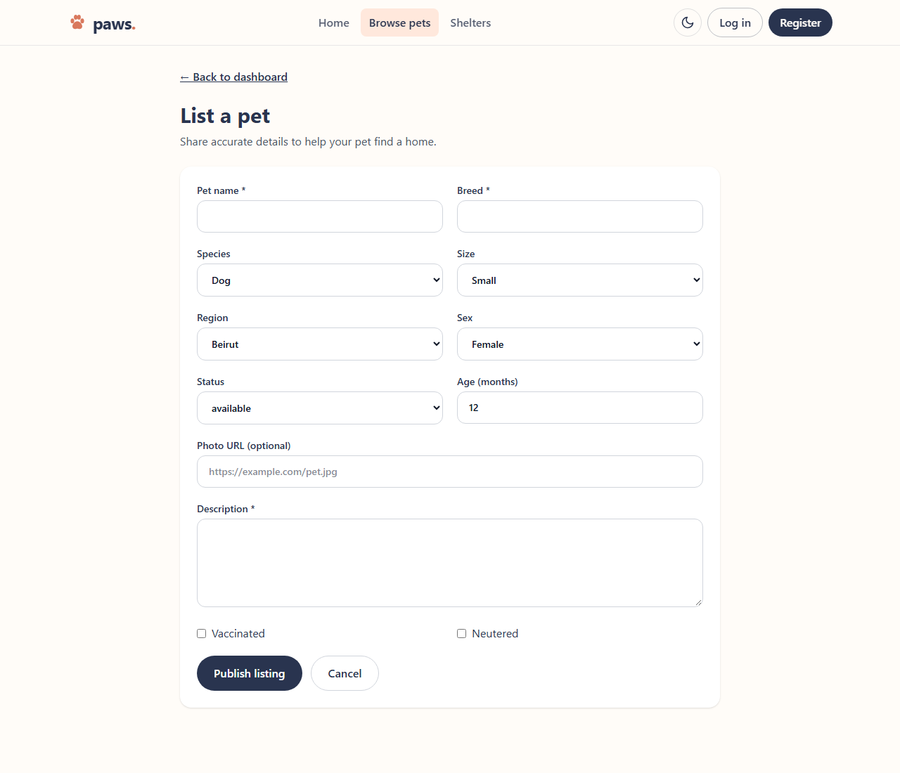

**Edit a pet**
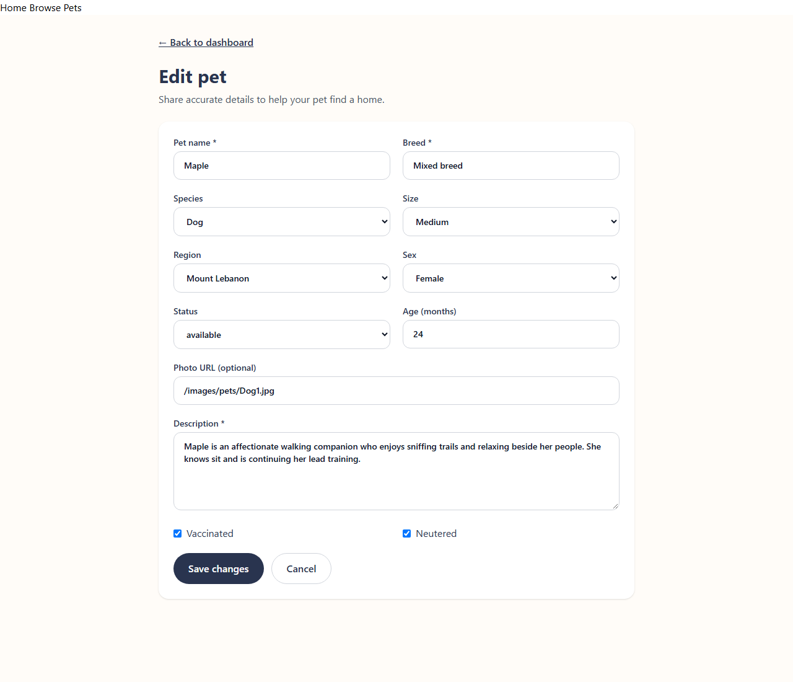

**Register**
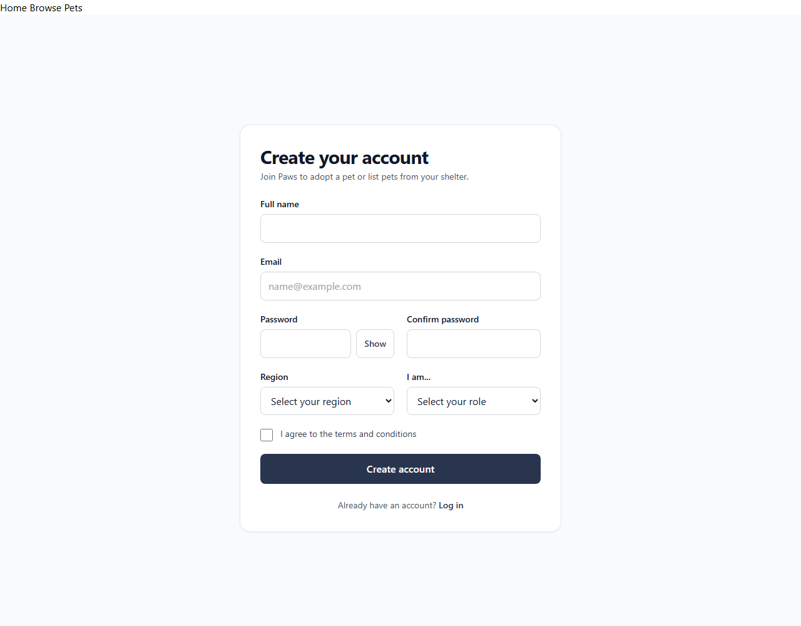

**Login** (with the one-click demo buttons)
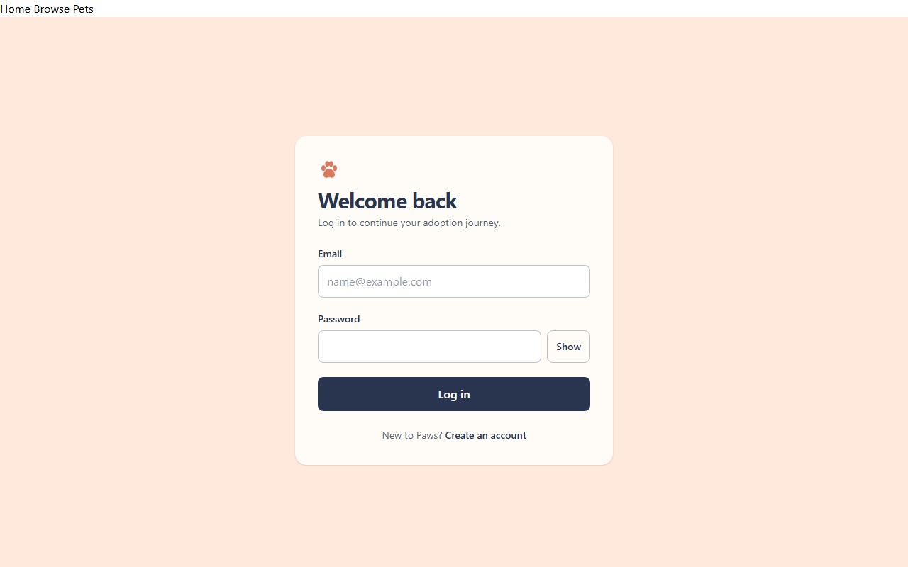

**Page not found**
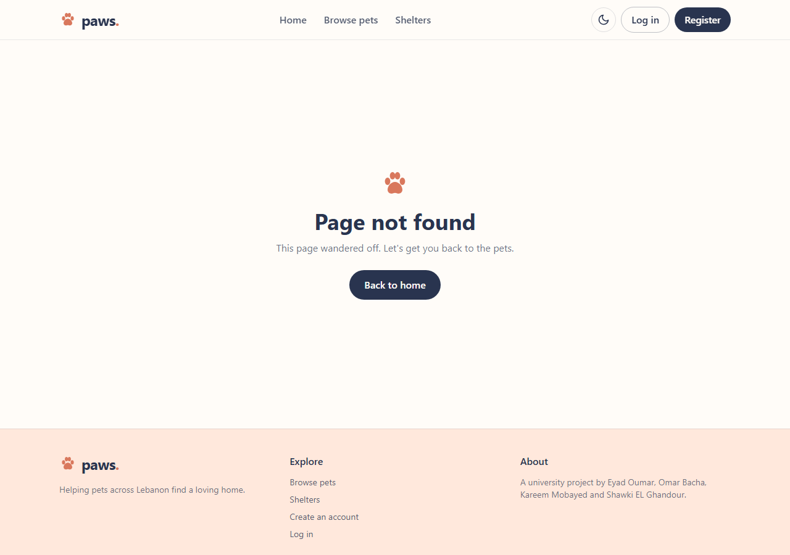

**Pet List on a phone** (the top bar turns into a menu button)

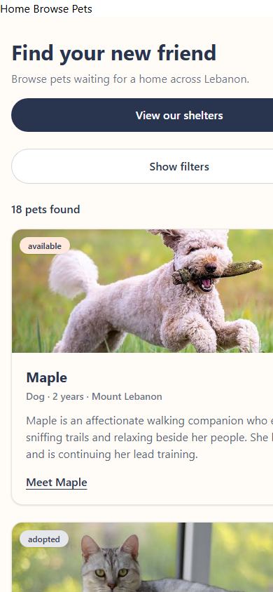

## What each member built

### Eyad Oumar: Pet List and Register
- **Pet List** (`/pets`): shows every pet as a card with a status badge. You can search by name or breed and filter by species, age, size, region and status. The filters are saved in the web address, so a filtered list can be shared, and the species links on the Home page open the list already filtered. It shows how many pets match, has a "Clear filters" button and a message when nothing matches. On phones, the filters hide behind a "Show filters" button.
- **Register** (`/register`): a sign-up form for adopters and shelters. Every field is checked (for example, a valid email, a password with at least 8 characters including a letter and a number, matching passwords). Each error appears under its field. Choosing "I'm a shelter" shows extra shelter fields. There is a show/hide password button.
- **Top bar and footer** (on every page): the top bar has the logo and links to Home, Browse pets and Shelters, and highlights the page you are on. It shows Log in and Register, or Dashboard and Log out once you are logged in. On phones, the links fold into a menu button. The footer has quick links, the team names and the copyright line.
- **Dark mode**: a moon/sun button in the top bar switches the whole site between light and dark. It remembers your choice, and the first time it follows your device's setting.
- Also: the one-click demo login buttons, the "Page not found" page, the shared lists of allowed values (`constants.js`), the mock data and helper functions, and the paw favicon.

### Omar Bacha: Home and Login
- **Home** (`/`): the landing page with featured pets and quick links to browse pets by species.
- **Login** (`/login`): a login form with checks on the email and password. A correct login remembers who is logged in and opens the dashboard.
- Also: the shared data provider that gives every page the same data.

### Kareem Mobayed: Pet Details and Shelter Details
- **Pet Details** (`/pets/:id`): one pet's photo, facts (species, breed, age, sex, size, region), description, its shelter, and an adopt button that is disabled if the pet is not available.
- **Shelter Details** (`/shelters/:id`): one shelter's information and the pets it cares for.

### Shawki EL Ghandour: Dashboard and Add/Edit pet form
- **Dashboard** (`/dashboard`): the user's own page, reached from the top bar once you are logged in. It has three tabs. **My listings** shows the pets they listed, with a search box, a status filter, and View, Edit and Delete buttons. **My requests** shows the adoption requests they sent. **Received requests** shows requests for their pets, with Approve and Reject buttons. Approving a request marks the pet as adopted. Counters at the top show the number of listings, received requests and adopted pets.
- **Add/Edit pet form** (`/pets/new` and `/pets/:id/edit`): one form to list a new pet or change an existing one. Required fields are checked before saving, and you can only edit your own listings.
- For now, the dashboard and the form always use the demo account (Alex), not the account that logged in.

## How the mock data works

There is no server yet, so the app pretends to have one:

1. **The starting data** is written in [`src/data/mockData.js`](src/data/mockData.js): 8 users, 3 shelters, 18 pets and 12 adoption requests.
2. **When the app opens**, a shared data box (`AppDataProvider` in [`src/context/AppDataContext.jsx`](src/context/AppDataContext.jsx)) makes a copy of that data and keeps it in React state.
3. **Every page reads from the same box** using `useAppData()`. For example, the Pet List shows `data.pets` and the Home page picks the featured pets from it.
4. **Pages can change the data** with `setData`. For example, logging in saves who is logged in. Because it is React state, every page that shows that data updates straight away.
5. **Refreshing the page resets everything** to the starting data, because nothing is saved anywhere. This is expected in Phase 1.

Some helper files keep the data consistent:
- [`src/data/constants.js`](src/data/constants.js): the allowed values (species, sizes, regions, statuses, roles, age groups), so every page uses the same spelling.
- [`src/data/selectors.js`](src/data/selectors.js): small functions to get data, like `getFeaturedPets` or `getPetAgeLabel` (turns `30` months into "2 years 6 months").

In Phase 2, the starting data will come from a Node.js server instead. The pages will still use `useAppData()`, so they will need very few changes.

## Built with

- [React](https://react.dev/) (with function components and hooks)
- [React Router](https://reactrouter.com/) for moving between pages
- [Tailwind CSS](https://tailwindcss.com/) for styling, mobile first, with a dark mode
- [Vite](https://vite.dev/) to run and build the project
- Git and GitHub, with a branch and a pull request for every change

## Project folders

```
public/images/      pet and shelter photos
src/components/     reusable pieces (Navbar, Footer, ThemeToggle, PetCard, FilterBar, ...)
src/context/        the shared data provider
src/data/           mock data, allowed values and helper functions
src/pages/          one file per page
```
